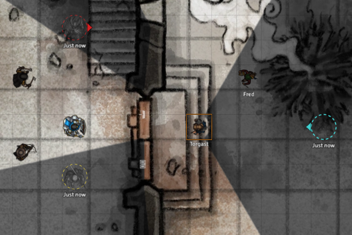

# Situational Awareness

A Foundry VTT module that marks where hostiles were last seen and which way they went, and keeps nearby allies visible through the fog of war.



## Installation

In Foundry, open **Add-on Modules → Install Module** and paste this manifest URL:

```
https://github.com/PuffMannen/SituationalAwareness/releases/latest/download/module.json
```

Enable the module in your world. Both features are on by default. Requires Foundry VTT V14 and works with any game system.

## Last known positions

When a tracked token leaves your sight, a marker stays where you last saw it. An arrow shows which way it was moving, and a label shows how many rounds ago you saw it.

- **Shared:** while any player can see a tracked token, the rest of the party sees a marker that follows it.
- **Shared by the GM:** a token the GM controls, such as a friendly NPC, a charmed hostile or the token of a player who couldn't join, shares what it sees when its **Share Sightings With Party** option is on. Set it in the token's Vision tab, or for every selected token with the Token HUD button. Nothing is shared while the GM also controls a token without the option.
- **Cleared:** when you see the token again, or see its spot again with the token gone. Clearing every marker on a scene works through the Token controls or a key binding. A GM fog reset or hiding a token also clears them.
- **Saved:** markers survive reloads and scene changes.

By default only hostile tokens are tracked. Neutral tokens and allies you don't own can be tracked too.

### Customizing markers

As GM, click **Customize Markers** in the module settings. Hostiles and allies each have their own tab. Start from a preset (Classic, Modern tactical, Espionage, Science fiction, Arcane fantasy, Horror, Western, Tracker or Minimal), then adjust color, size, shape, outline, heading arrow, image, label and animation.

## Proximity awareness

Allies close to one of your tokens stay visible, even around corners or in darkness. They're tinted like explored fog to show you sense them rather than see them. Tokens with a secret disposition are never revealed.

## Settings

| Setting | Default | What it does |
| --- | --- | --- |
| Proximity Awareness | On | Keep nearby allies visible. |
| Proximity Range | 2 grid spaces | How close an ally must be. |
| Proximity Targets | Player-owned and friendly | Which tokens proximity covers. |
| Walls Block Proximity | Off | Walls between tokens cancel proximity. |
| Last Known Positions | On | Leave markers where tracked tokens were last seen. |
| Tracked Tokens | Hostile | Which non-allied tokens leave markers. |
| Track Allies | On | Leave markers for allies you don't own. |
| Share Sightings With Party | On | Share markers with the whole party. |
| Marker Lifetime | 0 (never) | Remove markers after this many rounds. |
| Clear Empty Markers | On | Fade out a marker when its spot is seen empty. |
| Clear Delay | 2 seconds | How long an empty spot must stay in view first. |
| Show Markers to Game Master | Off | Give the GM markers while controlling tokens. Only the GM sees them. |

Show Markers to Game Master is set per client. All other settings are world settings, changed by the GM.

## Good to know

- Each player's markers come from their own vision, so players who see differently can have different markers.
- Proximity is measured in a straight line between token centers.

## API

```js
const api = game.modules.get("situational-awareness").api;
api.clearMarkers();           // Remove this user's markers on the current scene
api.getSightings();           // Sighting data for the current scene
api.isProximityAware(token);  // Whether proximity keeps this token visible
api.refresh();                // Re-evaluate all features
```

To build or contribute, see [CONTRIBUTING.md](CONTRIBUTING.md).

## Support

Questions and ideas go in [Discussions](https://github.com/PuffMannen/SituationalAwareness/discussions). Bugs go in [Issues](https://github.com/PuffMannen/SituationalAwareness/issues); please include your Foundry version and game system.

## License

[MIT](LICENSE). Foundry Virtual Tabletop is covered by its own terms.
